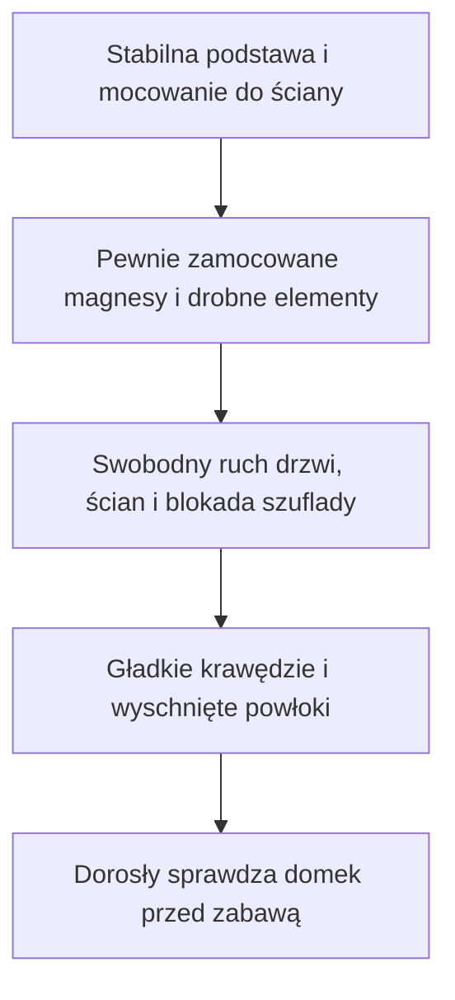
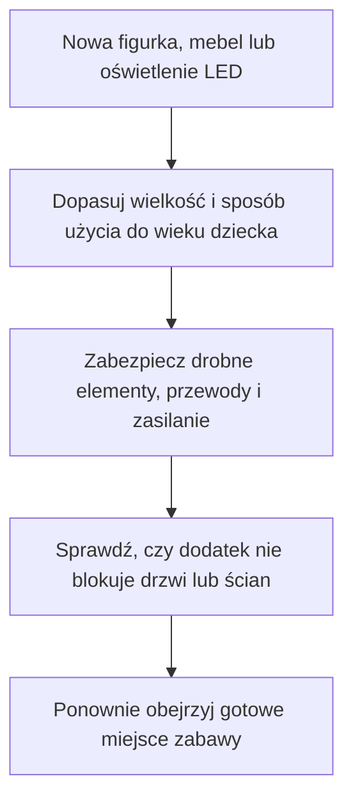

Lanternwood House to domek, który możesz urządzić razem z dzieckiem dla jego ulubionych mieszkańców. Pokoje pomieszczą własnoręcznie robione meble, małe książki, uszyte kołdry i figurki, które już macie. Rodzina pokazana w projekcie jest jedną z możliwości.

Pomysł jest prosty: udostępnić otwarty projekt konstrukcji, a rodzicom i dzieciom zostawić wybór kolorów, wyposażenia i historii. Gotowe plany można pobrać, części zlecić do wycięcia ze sklejki, a potem złożyć i wykończyć domek we własnym tempie.

Może zamieszkać w nim ukochany królik, rodzina drewnianych lalek albo bohaterowie wymyśleni przez dziecko. Przed budową warto zmierzyć największą figurkę i porównać ją z wymiarami pokoi oraz drzwi. Otwarty projekt daje możliwość zmian, ale powiększenie całego domu wymaga przygotowania dopasowanych planów.

## Cztery poziomy, otwierane ściany i miejsce na własne meble

Domek ma kształt okrągłej wieży złożonej z płaskich ścian. W środku znajdują się parter, dwa piętra i poddasze. Dwie przednie części ściany otwierają się na zawiasach, dzięki czemu można sięgnąć do pokoi i przestawiać wyposażenie. Dach jest zdejmowany, więc również na poddaszu da się urządzić sypialnię albo pracownię.

Przy planowaniu miejsca w pokoju przydadzą się te wymiary:

| Element                  | Wymiar obecnego projektu |
| ------------------------ | ------------------------ |
| Wysokość całego domku    | Około 78 cm              |
| Średnica podstawy        | Około 52 cm              |
| Średnica samej wieży     | Około 33 cm              |
| Wysokość głównych pokoi  | Około 13,4 cm            |
| Podest werandy           | Około 15 × 8,4 cm        |
| Wysuw szuflady           | 20 cm                    |
| Otwarcie przednich ścian | Do 100°                  |
| Sklejka w planach        | Grubości 3 mm i 6 mm     |

Podstawa ma nieco ponad pół metra średnicy, a otwierane ściany potrzebują dodatkowego miejsca po bokach. Szuflada wysuwa się z tyłu, po prawej stronie. Warto uwzględnić to, zanim wybierzesz miejsce na gotowy domek.

### Weranda, okna i ozdoby do wspólnego wykańczania

Boczna weranda ma schodki, balustradę i własny daszek. Nad nią biegnie drabinka sznurowa. Dwie lukarny, czyli małe okna wystające z dachu, doświetlają poddasze. Okna w wieży otaczają jasne ramki, a cokół można wykończyć tak, żeby przypominał kamień.

W pakiecie są wzory dekoracji, w tym papierowe pasy dachówek. Możesz skorzystać z proponowanych kolorów albo razem z dzieckiem wybrać zupełnie inną wersję. Pokoje mogą dostać tapety z dziecięcych rysunków, a podłogi małe dywany ze skrawków tkaniny.

### Szuflada na wyposażenie, które akurat odpoczywa

W cokole ukryto szufladę na drobiazgi do zabawy. Przyda się na zapasową pościel, miniaturowe naczynia czy meble czekające na kolejny remont pokoju. Przewidziana blokada ogranicza jej wysuw, dlatego trzeba zamontować ją zgodnie z instrukcją.

## Najprostsza droga do własnego domku zaczyna się od gotowego pakietu

Cały pakiet projektu znajdziesz w [wydaniu LanternHouse v1.0.0 na GitHubie](https://github.com/hvitis/LanternHouse/releases/tag/v1.0.0). GitHub jest tutaj miejscem przechowywania plików. Do ich pobrania i przekazania wykonawcy nie trzeba umieć programować.

Na zrzucie widać opis zawartości pakietu, od pełnej książki budowy po osobne dokumenty do wycinania części.

Na stronie wydania odszukaj sekcję Assets, czyli pliki do pobrania. Najwygodniej zacząć od archiwum Lanternwood-House-Build-Kit.zip. W przygotowanym zestawie są dokumenty do budowy, rysunki części i materiały pomocnicze.

Do rozmowy z firmą wycinającą elementy przydadzą się przede wszystkim dwa dokumenty: Lanternwood-House-Supplier.pdf oraz Lanternwood-House-Supplier-Cut.dxf. Pierwszy opisuje wymagania i materiały. Drugi zawiera linie, według których maszyna ma wyciąć części. PDF możesz otworzyć jak zwykłą instrukcję, a plik DXF przekazujesz wykonawcy.

### Wyślij plany firmie, która wycina sklejkę

Szukaj usługi cięcia laserowego sklejki lub wycinania elementów na frezarce. W praktyce nie chodzi o nadruk na drewnie, tylko o otrzymanie gotowych kształtów do złożenia. Nie musisz kupować maszyny ani samodzielnie wycinać wszystkich ścian.

1. Pobierz pakiet i przeczytaj ilustrowaną instrukcję, żeby ocenić zakres montażu.
2. Wyślij firmie dokument dla wykonawcy i rysunek do cięcia. Poproś o wycenę materiału, cięcia, potrzebnych otworów i wysyłki.
3. Potwierdź z wykonawcą grubości sklejki, sposób oznaczenia części oraz to, co pozostanie do zrobienia ręcznie.
4. Najpierw zamów małe próbki połączeń z tego samego materiału. Sprawdź dopasowanie, zanim zlecisz cały domek.
5. Po otrzymaniu części porównaj je z listą, złóż próbnie bez kleju i dopiero potem rozpocznij właściwy montaż.

Obecny układ części przygotowano pod cięcie laserowe. Firma korzystająca z frezarki musi uwzględnić inne odstępy i sposób obróbki. Części ze sklejki to również tylko część zakupów: potrzebne będą między innymi zawiasy, wkręty, klej i elementy z litego drewna wskazane w instrukcji.

### HDF jest tańszą możliwością do wyceny, ale wymaga dopasowania projektu

HDF to płyta ze sprasowanych włókien drzewnych. Może obniżyć koszt materiału w porównaniu ze sklejką. W [porównanej ofercie tego samego sprzedawcy](https://www.drecon-sklejka.pl/sklep/) arkusz HDF o tej samej grubości i powierzchni kosztował mniej od sklejki brzozowej. Ostateczna oszczędność zależy też od cięcia, wykończenia i transportu.

Plany Lanternwood House przygotowano dla sklejki. Przejście na HDF trzeba omówić z wykonawcą i osobą dostosowującą projekt, szczególnie w miejscach łączeń, mocowania zawiasów i podparcia podłóg. Poproś o osobną wycenę oraz próbki, zamiast zlecać zamianę materiału w całym domku bez sprawdzenia.

## Strona projektu pomaga od pierwszego oglądania do montażu

[Strona LanternHouse](https://hvitis.github.io/LanternHouse/) działa w przeglądarce. Nie trzeba instalować programu do projektowania. Cztery widoki pomagają obejrzeć domek, przygotować części i przejść przez montaż.

### Main view: obejrzyj domek i sprawdź dostęp do wnętrza

W głównym widoku można obracać domek, przybliżać szczegóły, otwierać ściany, podnosić dach i wysuwać szufladę. To dobry moment, żeby razem z dzieckiem wybrać przeznaczenie pokoi. Można też wskazać część i sprawdzić jej wymiary lub położenie.

### DXF preview: zobacz części przed wysłaniem ich do wycięcia

Ten widok pokazuje rysunek elementów rozłożonych na arkuszach. Można go powiększać, sprawdzać oznaczenia i pobrać plik dla wykonawcy. Nie trzeba rozumieć każdej linii. Ważne, żeby firma otrzymała rysunek oraz instrukcję z tego samego wydania projektu.

### 3D printables: wybierz dodatkowe meble

W kolekcji do druku 3D można obejrzeć meble i akcesoria, obracać je i pobierać udostępnione pliki. To osobna ścieżka rozbudowy wnętrza. Wyposażenie widoczne na wizualizacji nie jest automatycznie częścią zestawu elementów domku wycinanych ze sklejki.

### Instructions: zbieraj materiały i przechodź przez kolejne kroki

Przed rozpoczęciem montażu przewodnik pokazuje listę materiałów i narzędzi. Można zaznaczać przygotowane rzeczy i pobrać listę jako PDF, żeby zabrać ją do sklepu lub warsztatu.

Podczas budowy widok pokazuje części potrzebne do danego kroku i opisuje ich montaż. Można przybliżyć połączenie, obejrzeć je z innej strony i zaznaczyć ukończony etap. Na pokazanym przykładzie wyróżniono ramki okienne, które trzeba zamontować wokół okien wieży.

Postęp jest zapisywany w tej samej przeglądarce. Możesz więc wrócić do montażu po przerwie, korzystając z tego samego urządzenia. Przed klejeniem nadal warto mieć pod ręką papierową instrukcję i porównać położenie części z rysunkiem.

## Projektowanie z AI w czasie rzeczywistym zajęło dwa dni

Cyfrowy projekt domku przygotowałem z pomocą AI w dwa dni, na bieżąco oglądając kolejne wersje i wprowadzając poprawki. Zmiana pomysłu na okno, wyposażenie czy detal obudowy mogła od razu wrócić jako nowy widok, który dało się ocenić.

To czas opracowania projektu, nie obietnica złożenia drewnianego domku w jeden weekend. Cięcie, próbny montaż, klejenie i malowanie mają własne tempo, a klej oraz farby muszą wyschnąć zgodnie ze wskazaniami producentów.

Najbardziej zależy mi na tym, że efekt tej pracy można rozwijać dalej. Projekt jest otwarty, więc inni mogą przygotować własne zmiany i podzielić się nimi zgodnie z [licencją projektu](https://github.com/hvitis/LanternHouse/blob/main/LICENSE). Udostępniono go do użytku niekomercyjnego, z podaniem autora i zachowaniem tej samej licencji przy dzieleniu się zmianami.

Rodzic może zacząć od własnych kolorów i wyposażenia. Osoba pomagająca w projektowaniu może później dostosować większe elementy do ulubionej figurki albo innego układu pokoi. W obu przypadkach nowe części trzeba dopasować do reszty domku.

## Przed zabawą sprawdź gotowy domek

Obecna wersja jest projektem cyfrowym i czeka na pierwszy montaż ze sklejki. Ilustracje domku pokazują wizualizacje komputerowe. Projekt nie jest certyfikowaną zabawką, a dokumentacja opisuje konstrukcję i punkty, które trzeba sprawdzić po wykonaniu. Warto od początku zaplanować je jako część budowy.

Pierwszy schemat zbiera rzeczy, które łatwo przeoczyć, kiedy domek jest już pomalowany:

Instrukcja przewiduje zabezpieczenie domku przed przewróceniem przez mocowanie do ściany pokoju. Magnesy mają być całkowicie zamknięte w drewnie. Trzeba też sprawdzić blokadę szuflady, odsłonięte końce wkrętów i szczeliny przy ruchomych częściach. Przed oddaniem domku dziecku wygładź krawędzie i zastosuj wykończenie przeznaczone do przedmiotów dla dzieci.

Własne dodatki wymagają podobnej uwagi. Dotyczy to także gotowych figurek, małych mebli i oświetlenia:

Przy oświetleniu zadbaj o niedostępny dla dziecka pojemnik na baterie i zamocowane przewody. Prace przy zasilaniu powierz dorosłemu z odpowiednią wiedzą. Wygląd miniaturowej lampy to jedna decyzja, a sposób jej podłączenia i zamocowania wymaga osobnego sprawdzenia.

## Dokumentacja pozwala zacząć od domku i rozwijać własny świat

Najbardziej przydatna część pakietu zostaje z rodzicem przy stole: lista zakupów, oznaczenia części, rysunki połączeń i kolejność montażu. Osobne materiały pomagają porozumieć się z firmą wycinającą sklejkę, a przeglądarka pozwala przyjrzeć się temu samemu miejscu z kilku stron.

Po złożeniu konstrukcji można przejść do drobniejszych projektów. Z drukarki 3D mogą wyjść krzesła, wanna albo piecyk. Z modeliny da się ulepić mieszkańców, naczynia i dekoracje. Ze skrawków materiału powstaną zasłony, a z tektury regał na miniaturowe książki. Oświetlenie LED i kolejne elementy można dodawać stopniowo, po dopasowaniu ich do dziecka i domku.

Rodzina Rowan z poradnika nie musi być waszą rodziną domowników. Zacznijcie od postaci, którą dziecko najbardziej lubi, i urządźcie dla niej jeden pokój. [Pobierz pakiet v1.0.0](https://github.com/hvitis/LanternHouse/releases/tag/v1.0.0), obejrzyjcie razem [domek w przeglądarce](https://hvitis.github.io/LanternHouse/) i wybierzcie pierwszy mebel, który zrobicie własnymi rękami.
