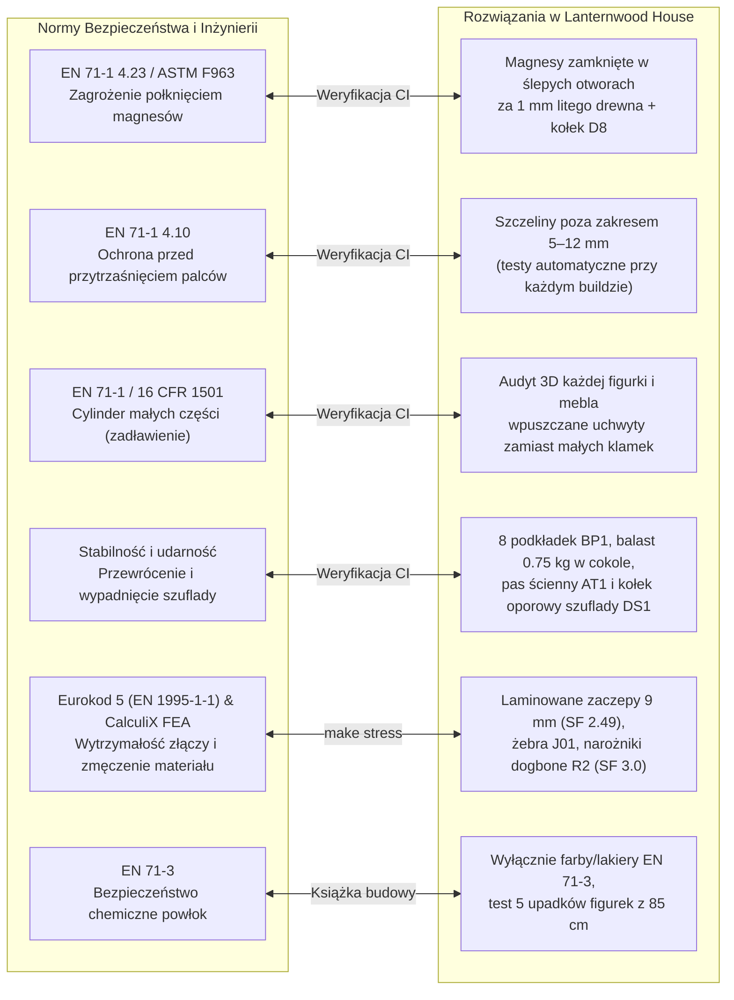

# Lanternwood House: Drewniany domek ze sklejki w całości generowany z kodu

**Jeden skrypt w Pythonie. Jeden plik konfiguracji. Prawdziwy, pachnący drewnem świat do zabawy.**

Wyobraź sobie okrągłą, błękitną wieżę ze spiczastym czerwonym dachem, dwiema lukarnami na poddaszu, boczną werandą z drabinką sznurową, tylnym wyjściem do drewutni i kamiennym cokołem, który skrywa tajną szufladę. Kiedy otworzysz frontowe skrzydła ścian na kąt 100° i uniesiesz dach, Twoim oczom ukażą się cztery kondygnacje gotowe na przyjęcie mieszkańców – ulepionej z modeliny rodziny Rowan: Eliasa, Miry, Ady i małego Theo.

Tak wygląda **Lanternwood House** – autorski, otwartoźródłowy projekt dużego domku dla lalek (prawie 80 cm wysokości!) ze sklejki brzozowej 3 mm i 6 mm. Najbardziej niezwykłe jest jednak to, jak ten domek powstał: **żaden rysunek, żaden szablon i żaden plik 3D nie został narysowany ręcznie myszką**. Cała konstrukcja (~265 części mieszczących się na 21 arkuszach A3), natywne złożenie **FreeCAD 1.1+**, bryły STEP, rozkroje laserowe/CNC w formacie DXF R12, 224-stronicowa książka budowy A4 z szablonami 1:1 oraz interaktywna przeglądarka 3D w Three.js są kompilowane automatycznie z czystego kodu w Pythonie.


---

## Projektowanie i tworzenie z AI: Nowa era inżynierii parametrycznej (*Code-CAD*)

Tradycyjne projektowanie CAD w programach okienkowych przypomina rzeźbienie w glinie, która zbyt szybko zastyga. Gdy po dwóch tygodniach rysowania setek części postanowisz zmienić grubość sklejki z 4 mm na 3 mm, obniżyć dach o 4 centymetry albo przesunąć werandę na sąsiednią ścianę dwunastokąta – klasyczne drzewo operacji w GUI bardzo często rozsypuje się w lawinie błędów topologicznych (*topological naming problem*).

W **Lanternwood House** przyjęliśmy zupełnie inne podejście: **Code-CAD wspomagany przez AI**.


### Dlaczego duet „Człowiek + AI + Kod” zmienia reguły gry?

1. **Język kodu jako wspólny mianownik dla AI i inżyniera:** Modele językowe nie potrafią precyzyjnie „klikać” w oknach programu CAD, ale doskonale rozumieją geometrię analityczną, trygonometrię, transformacje macierzowe i kod w Pythonie (`source/model.py`, `source/architecture.py`, `build123d`). Zamiast ręcznie kreślić wpusty i czopy, definiujemy reguły architektoniczne w kodzie, a AI pomaga błyskawicznie przeliczać kąty dwunastokątnej wieży, nachylenia połaci dachowych, podcięcia lukarn i łańcuchy wymiarowe.
2. **Wizualna pętla zwrotna na żywo (`make studio` + oczy dla AI):** Podczas projektowania mebli do druku 3D (`source/prints/`) serwer `make studio` nasłuchuje zmian w plikach Pythona i przebudowuje model w przeglądarce w około **0,5 sekundy** bez resetowania kamery. Co więcej, narzędzie `node source/print_shot.mjs` wykonuje automatyczne zrzuty ekranu z czterech rzutów i zaznacza na czerwono zbyt ostre nawisy (*overhangs*) oraz zbyt cienkie ścianki. Agent AI może wygenerować bryłę, „spojrzeć” na gotowe rendery kontrolne i samodzielnie poprawić geometrię, zanim człowiek zdąży uruchomić slicera!
3. **Jedna zmiana w `config.json` aktualizuje cały świat:** Gdy w rewizji 7 obniżyliśmy stożek dachu o 40 mm i zredukowaliśmy asortyment sklejki wyłącznie do grubości **3 mm oraz 6 mm**, jeden przebieg kompilacji (`make all`) automatycznie przeliczył trójkątne połacie dachu (`R01`, `R06`), lukarny (`DM01–DM06`), skośne ścianki komina (`CH1–CH4`), szablony kątowe (`R05`) oraz 138 papierowych pasów gontów wycinanych po łuku.
4. **Algorytmiczna optymalizacja kosztów i materiału:** Skrypt `source/nest.py` pakuje części na arkuszach A3 za pomocą korelacji FFT na siatce 1 mm, wkładając drobne detale do wnętrza pierścieni dachowych i wycinków koła w 24 równoległych wariantach kolejności. Z kolei narzędzie `make stock` analizuje cenniki dostawców sklejki i generuje gotowy raport PDF z najtańszą kombinacją arkuszy i formatek.

---

## Fundament kreatywności: Otwarte wnętrze, rękodzieło i wspólne tworzenie

Tworzenie fizycznych, namacalnych przedmiotów dla dzieci ma wartość, której nie zastąpi żaden ekran. Jeszcze ważniejsze jest jednak to, **jak** ten przedmiot działa na wyobraźnię. Komercyjne, plastikowe domki ze sklepu są zazwyczaj skończone w każdym calu – narzucają gotową estetykę, pstrokate naklejki i jeden scenariusz zabawy.

**Lanternwood House został zaprojektowany jako żywe płótno i rdzeń kreatywności.**


### Rzemiosło spotyka wyobraźnię: Co kryje wnętrze wieży?

Konstrukcja ze sklejki daje dziecku solidną, bezpieczną architekturę – trzy przestronne piętra (o wysokości 134 mm w świetle), poddasze, ścianki działowe z otwieranymi drzwiami na zawiasach z taśmy bawełnianej oraz ukrytą w cokole szufladę na skarby. Jednak **wnętrze domku celowo pozostaje polem do ręcznego tworzenia (*handmade*) i dalszego projektowania**:

- **Własnoręczne lepienie mieszkańców z modeliny (`source/clay.py`):** Czteroosobowa rodzina Rowan (Elias z latarnią, Mira, Ada i Theo) została opisana w kodzie za pomocą gładkich unii pól odległości (*Signed Distance Fields*), a ich objętość jest całkowana metodą maszerujących czworościanów (*marching tetrahedra*). Po co? Aby w książce budowy (`Lanternwood-House-Clay-Family.pdf`) podać rodzicowi i dziecku **dokładną gramaturę każdego koloru modeliny co do grama** oraz pokazać, ile materiału zaoszczędzi uformowanie rdzenia z folii aluminiowej! Sam proces lepienia, nadawania wyrazu twarzom i wypiekania figurek w domowym piekarniku to wspaniały rytuał twórczy.
- **Ręcznie robione mebelki, tekstylia i dekoracje:** Książka budowy zawiera szablony papierowych gontów typu „rybia łuska” (układanych warstwa po warstwie na dwunastokątnym dachu), kamienne okładziny cokołu oraz paletę barw. Pokoje można wytapetować własnymi rysunkami, uszyć ze skrawków materiału pościel, zasłonki i dywaniki, a mebelki zbudować ręcznie z patyczków, korka, pudełek po zapałkach i resztek sklejki pozostałych po wycięciu okien.
- **Studio druku 3D i dalsze projektowanie CAD:** Dla tych, którzy chcą połączyć stolarkę z nowoczesnym warsztatem, repozytorium udostępnia kolekcję parametrycznych mebli w `source/prints/` (m.in. piec kaflowy *kakelugn*, żyrandol, wanna na łapach, stół, krzesła) oraz rozbudowaną koncepcję **Archiwum Literackiego i Skryptorium** (`IMPROVEMENTS.md`) – z prasą introligatorską, 16-szufladowym katalogiem bibliotecznym, obrotowym stolikiem na książki i sekretną skrytką w podwójnym dnie szuflady.


Dziecko nie dostaje więc zamkniętego produktu, lecz **własny mały świat**, który rośnie razem z nim – od pierwszego szlifowania krawędzi papierem ściernym, przez malowanie ścian, aż po samodzielne wymyślanie i dodawanie nowych mebli w kolejnych latach.

---

## Bezpieczeństwo przede wszystkim: Inżynieria zabawek (EN 71) i testy wytrzymałościowe MES

Kiedy projektujemy przedmiot ze sklejki, drewna i metalu ważący ponad 6 kilogramów, z którym na co dzień będzie obcować **trzyletnie dziecko**, radosna improwizacja musi ustąpić miejsca bezwzględnej inżynierii bezpieczeństwa. Dzieci nie obchodzą się z zabawkami delikatnie: opierają się całym ciężarem na otwartych drzwiczkach, ciągną za szuflady, wkładają palce w każdą szczelinę i próbują wszystkiego dotknąć lub ugryźć.

Dlatego w **Lanternwood House** wdrożyliśmy pełny audyt ryzyka (`RISKS.md`), zautomatyzowane skrypty kontroli bezpieczeństwa zgodne z normami **EN 71-1, EN 71-3, ASTM F963 oraz 16 CFR 1500/1501** (`source/risk_audit.py`), analizę łańcuchów tolerancji (`source/stackup.py`) oraz **symulacje wytrzymałościowe Metodą Elementów Skończonych (CalculiX FEA) i obliczenia konstrukcji drewnianych według Eurokodu 5 (EN 1995-1-1)** (`source/run_stress_tests.py`).



### 1. Eliminacja zagrożeń dla 3-latka (`RISKS.md` & `make stackup`)

Każda kompilacja projektu uruchamia zautomatyzowany audyt bezpieczeństwa, który zatrzymuje budowę, jeśli którykolwiek z warunków zostanie naruszony:

- **Pancerna kapsuła dla magnesów neodymowych (`RISK-01`):** Magnesy neodymowe D8 × 3 mm utrzymujące ściany mają wskaźnik strumienia magnetycznego znacznie przekraczający próg 50 kG²·mm² – ich połknięcie jest śmiertelnie niebezpieczne, więc samo wklejenie w otwór na powierzchni jest niedopuszczalne. W naszym projekcie wszystkie 4 magnesy spoczywają w **litym twardym drewnie** (klocki zaczepów `MC1` i słupki ogrodowe `GP1`). Są wkładane od **ukrytej strony** w ślepy otwór zatrzymujący się **1 mm przed powierzchnią roboczą drewna**, a z tyłu zamykane wklejonym na stałe bukowym kołkiem D8 (`magnets.skin`, `.bore`, `.plug`). Magnes jest całkowicie niewidoczny i fizycznie zamknięty w drewnie!
- **Ochrona paluszków przed przytrzaśnięciem (`RISK-03`) i ostrymi krawędziami (`RISK-04`):** Zgodnie z normą EN 71-1 4.10 najbardziej niebezpieczne są szczeliny o szerokości od 5 do 12 mm. Testy geometryczne pilnują, by żadna szczelina między otwieranymi ścianami a stropami i przegrodami nie wpadła w ten przedział. Z kolei tradycyjne, spiczaste zwieńczenie dachu zastąpiono gładką, toczoną kulą bukową o średnicy **35 mm (`FN01`)**.
- **Test cylindra małych części (`RISK-05`, `RISK-07`):** Zarówno generator figurek z modeliny (`clay.py`), jak i walidator wydruków 3D (`print_mesh.py`) sprawdzają wymiary każdego luźnego elementu względem znormalizowanego cylindra małych części EN 71-1 (średnica 31,7 mm, długość 57,1 mm). Małe przyklejane klamki drzwi zastąpiono wyfrezowanymi podchwytami na palec, a cienkie szprosy okienne zastąpiono litym krzyżem wyciętym bezpośrednio w ścianie i wzmocnionym jednoczęściową ramą `WF1` (44 × 78 mm, `RISK-06`).
- **Uwięziona szuflada (`RISK-08`) i bezpieczne LED-y:** Aby dziecko nie wyciągnęło ciężkiej szuflady i nie upuściło jej sobie na stopy, po wsunięciu szuflady od spodu podstawy `B01` wbijany jest kołek oporowy D6 (`DS1`). Zatrzymuje on szufladę po wysunięciu na 200 mm (56 mm pozostaje w prowadnicach) i jednocześnie centruje jej ślizg. Opcjonalne oświetlenie LED całkowicie rezygnuje z niebezpiecznych baterii guzikowych, prowadząc przewody w ukrytym kanale za tylnym słupkiem do niedostępnej dla dziecka komory za blokadą szuflady.
- **Stabilność i odporność na przewrócenie (`RISK-02`):** Skrypt `risk_audit.py` oblicza masę każdego z 265 elementów oraz przesunięcie środka ciężkości przy otwarciu obu przednich ścian o 100°. Pod krawędzią podstawy dodano 8 podkładek obwodowych `BP1` (zwiększających ramię podparcia ze 180 mm do 231 mm), wewnątrz cokołu umieszczono dwa stalowe płaskowniki balastowe (0,75 kg), a w tylnej ścianie zaprojektowano blok kotwiący `AB1` pod obowiązkowy pas meblowy `AT1` mocowany do ściany pokoju.


### 2. Prawdziwe testy wytrzymałościowe: CalculiX FEA, Eurokod 5 i tolerancje sklejki

Skąd wiadomo, że drewniany zaczep, zawias albo strop ze sklejki nie pęknie, gdy trzylatek naciśnie na niego z siłą kilku kilogramów? Uruchamiamy komendę `make stress` (`source/run_stress_tests.py`), która buduje siatki elementów skończonych w **Gmsh**, rozwiązuje równania naprężeń w solverze **CalculiX FEA** i weryfikuje połączenia ciesielskie według **Eurokodu 5**:

1. **Przypadek obrotowego zaczepu dachu (`RISK-12` – triumf analizy FEA):**
   Pierwotnie zaczepy trzymające dach (`E08`) miały grubość 3 mm. Kiedy przyłożyliśmy w symulacji CalculiX realistyczną siłę 32 N na końcu języczka, naprężenia sięgnęły **53,9 MPa** przy dopuszczalnych ~20 MPa (**współczynnik bezpieczeństwa SF = 0,37** – natychmiastowe złamanie!). Pogrubienie do 6 mm obniżyło naprężenia do 15,7 MPa (SF = 1,26 – wciąż za mało jak na zabawkę). Dopiero zaprojektowanie klejonego laminatu **6 mm (`E08`) + 3 mm (`E09`) = 9 mm** ze stopniowaną szyjką 22 mm i stalowymi podkładkami poszerzanymi D12 zredukowało naprężenia do **7,9 MPa, dając bezpieczny współczynnik SF = 2,49**!
2. **Karby, stropy i wyrywanie wkrętów (`RISK-09` – `RISK-14`):**
   - W narożach otworów pod cztery główne słupki nośne `P01` dodano odciążenia *dogbone* o promieniu **R2**, podnosząc odporność na pękanie wzdłuż włókien do **SF = 3,0**.
   - Płyty stropowe 6 mm są łączone w osi domku frezowanym złączem typu **puzzle** oraz złączem grzebieniowym (*finger joint*) z luzem montażowym 0,1 mm i podparte od spodu listwami podłużnymi (naprężenia zginające 8,6 MPa wobec dopuszczalnych 19,7 MPa).
   - Obliczenia wyrywania wkrętów z klocków zawiasowych z twardego drewna bukowego (`A02` i `A03`) potwierdziły zapas nośności **SF = 1,72** dla całych skrzydeł ścian i **SF = 1,9** dla drzwi, a słupki oporowe `GP1` wzmocniono dwoma kołkami bukowymi D4 przejmującymi ścinanie boczne (**SF = 2,0**).
   - Aby zrekompensować odchudzenie ścian wieży z 6 mm do 3 mm (`RISK-25`), zaprojektowano szerokie żebra narożne `J01`, które spinają jednocześnie trzy sąsiednie segmenty dwunastokąta na ~75% ich szerokości (~62 mm ramienia klejenia), zajmując przy tym zaledwie 10 mm głębokości pokoju.
3. **Symulacja skrajnych grubości sklejki (`make stackup` i `make tolerance`):**
   Sklejka brzozowa o nominalnej grubości 6 mm potrafi mieć w rzeczywistości od 5,7 mm do 6,3 mm. Skrypt `stackup.py` liczy 11 łańcuchów tolerancji (dzięki temu wykrył, że przy sklejce 6,4 mm ścianki działowe zakleszczyłyby się między piętrami, co naprawiliśmy 1-milimetrowym luzem kompensacyjnym `partition.top_gap`). Następnie `thickness_check.py` **przebudowuje w FreeCADzie cały domek dwukrotnie – dla najcieńszej i najgrubszej sklejki** – i dla obu skrajnych wariantów sprawdza ruch ścian co 5° (od 0° do 100°), ruch wszystkich 6 drzwi, wysuw szuflady i podnoszenie dachu!


---

## Architektura techniczna i parametry domku

Cały projekt opiera się na czystym podziale między dwa środowiska uruchomieniowe Pythona:
- **Python wbudowany we FreeCAD 1.1+ (jądro OpenCASCADE):** odpowiada za generowanie brył B-Rep (`build_cad.py`), audyt styków (`audit_connections.py`), symulacje tolerancji grubości (`thickness_check.py`) oraz solver MES CalculiX (`run_stress_tests.py`).
- **Standardowy Python 3.12+ (`.venv`):** błyskawicznie buduje model matematyczny (`model.py`), rozkłada części na arkuszach (`nest.py`, `stock.py`), renderuje grafikę (`render.py`, `cover.py`), składa 9 dokumentów PDF w ReportLab (`book.py`) i serwuje lokalną przeglądarkę 3D (`serve.py`).

### Główne parametry konstrukcyjne (domyślny `source/config.json`)

| Parametr | Wartość | Znaczenie w konstrukcji |
|---|---|---|
| **Wysokość całkowita** | 778,4 mm | Cztery kondygnacje (parter, 2 piętra, poddasze) pod dachem stożkowym |
| **Średnica podstawy / sklejka** | 522,7 mm / 6 mm | Okrągła podstawa z 8 podkładkami brzegowymi `BP1` |
| **Średnica wieży / ściany** | 326,7 mm / 3 mm | Dwunastokąt foremny (segmenty `W01`–`W12`), sklejka brzozowa kl. 2/2 |
| **Wysokość pomieszczeń** | 134,0 mm | Poziomy stropów 6 mm: Z73.6, Z213.6, Z353.6, Z493.6 |
| **Słupki nośne (`P01`)** | 4 szt. (6 × 16,8 × 402 mm) | Ciągłe filary przechodzące przez stropy z luzem 0,6 mm i odciążeniem R2 |
| **Kąt otwarcia ścian** | 100° | Dwa przednie skrzydła zawieszone 1 mm nad cokołem, zatrzymywane na słupkach `GP1` |
| **Szuflada w cokole** | Wysuw 200 mm | Ukryta w kamiennym cokole (wys. 61,6 mm) z kołkiem blokującym `DS1` |
| **Weranda boczna** | 149,3 × 84 mm (ściana `W07`) | Stała weranda ze schodami, tralkami i drabinką sznurową do lukarny |
| **Zapotrzebowanie na sklejkę** | 21 arkuszy A3 (297 × 420 mm) | 12 arkuszy 3 mm oraz 9 arkuszy 6 mm (~265 wycinanych elementów) |

 zespołów konstrukcyjnych domku')

---

## Jak zbudować własny domek? Od przeglądarki 3D do warsztatu

Nie potrzebujesz zainstalowanego programu FreeCAD, aby obejrzeć domek z każdej strony, zajrzeć do środka czy przejrzeć rysunki wykonawcze DXF.

### 1. Uruchom interaktywną przeglądarkę 3D i Studio Druku 3D
Możesz otworzyć [przeglądarkę online na GitHub Pages](https://hvitis.github.io/LanternHouse/) albo uruchomić ją lokalnie w kilka sekund:

```bash
git clone https://github.com/hvitis/LanternHouse.git
cd LanternHouse
python3 -m venv .venv
.venv/bin/python -m pip install -r requirements.txt
.venv/bin/python source/serve.py --open
```

W przeglądarce możesz płynnie otwierać ściany, drzwi, wysuwać szufladę, unosić dach, włączać widok rentgenowski, wyświetlać identyfikatory wszystkich części (**Piece IDs**) oraz przeglądać rozkroje DXF. Aby uruchomić żywe studio mebli do druku 3D, wystarczy wpisać `make studio`.

### 2. Wytnij części: Laser/CNC lub ręczna wyrzynarka
Projekt wspiera dwie równorzędne ścieżki wykonawcze:
- **Zlecenie cięcia laserem lub frezarką CNC (arkusze A3):** Przekaż wykonawcy gotowy plik `Lanternwood-House-Supplier-Cut.dxf` (wszystkie linie cięcia na warstwach 3 mm i 6 mm w standardzie R12) oraz polską specyfikację `Lanternwood-House-Supplier.pdf`. Przed zakupem materiału uruchom `make stock`, aby wyliczyć najtańszy zestaw arkuszy u wybranego dostawcy.
- **Praca ręczna w domowym warsztacie (szablony A4 1:1):** Wydrukuj `Lanternwood-House-Cutting-Templates.pdf` w skali 100% (każda strona posiada 100-milimetrowy pasek kalibracyjny o tolerancji ≤ 0,5 mm), naklej szablony na sklejkę i wytnij elementy wyrzynarką, korzystając z oznaczonych otworów startowych `S`.


---

## Co dalej? Od pojedynczego domku do uniwersalnego frameworku CAD

Lanternwood House stale ewoluuje. Najbliższe plany rozwojowe obejmują:
1. **Próbki pasowania (*Fit-test coupons*) i budowę prototypu ze sklejki:** Wycięcie próbnych złączy grzebieniowych i gniazd słupków przed finalnym montażem na sucho (*dry-fit*).
2. **Detale architektoniczne inspirowane Doliną Muminków (`IMPROVEMENTS.md`):** Ażurowa korona komina, falbanki podokapowe (*lambrequins*), rzeźbione narożniki werandy oraz pełny zestaw mebli CNC do **Archiwum Literackiego i Skryptorium**.
3. **Reusable CAD Framework (`docs/REUSABLE-CAD-FRAMEWORK-PLAN.md`):** Wydzielenie silnika geometrycznego, pakera FFT, generatora książek PDF, audytora bezpieczeństwa EN 71 i symulatora FEA do niezależnego frameworku, który pozwoli w ten sam sposób generować kolejne drewniane światy – zaczynając od **wielopoziomowego średniowiecznego zamku ze zwodzonym mostem**!


---

## Dlaczego wzorowa dokumentacja repozytorium ma fundamentalne znaczenie?

Na koniec warto zatrzymać się przy elemencie, który w projektach technicznych bywa traktowany po macoszemu, a w **Lanternwood House** stanowi jego najmocniejszy filar: **kompleksowej, wielowarstwowej dokumentacji repozytorium**.

Kiedy tworzysz projekt łączący oprogramowanie, inżynierię mechaniczną, stolarkę CNC i bezpieczeństwo dzieci, sam kod źródłowy – choćby najczystszy – nie wystarczy. Dobra dokumentacja pełni tu trzy kluczowe role:

1. **Most między cyfrowym modelem a fizycznym warsztatem:** Innych informacji potrzebuje programista rozwijający algorytm pakowania (`docs/PIPELINE.md`), innych rodzic z wyrzynarką w garażu (`docs/BUILD-GUIDE.md` oraz 224-stronicowa ilustrowana książka budowy), a jeszcze innych operator lasera CO₂ czy frezarki CNC w zewnętrznej firmie (`docs/SUPPLIER-READINESS.md` oraz generowany po polsku załącznik wykonawczy `Lanternwood-House-Supplier.pdf` z listą kontrolną przed wyceną). Co więcej, tabele wymiarów w `README.md`, `README.pl.md` i przewodniku budowy są aktualizowane automatycznie komendą `make specs`, a testy jednostkowe nie pozwolą na publikację, jeśli dokumentacja rozjedzie się z modelem!
2. **Jawny rejestr bezpieczeństwa i decyzji inżynieryjnych:** Dokumenty takie jak `RISKS.md`, `PLAN.md` oraz `docs/JOINT-VALIDATION.md` nie zamiatają trudnych problemów pod dywan. Dokumentują każdy wykryty problem wytrzymałościowy, wynik symulacji FEA, sposób jego rozwiązania oraz **ryzyka resztkowe**, które człowiek musi fizycznie zweryfikować podczas montażu na sucho (strona *„Dry-fit and safety checks”* w instrukcji).
3. **Pamięć długotrwała dla ludzi i agentów AI:** W dobie projektowania wspomaganego przez sztuczną inteligencję, precyzyjnie udokumentowane repozytorium – ze schematem `config.schema.json`, czytelnym opisem architektury i jawnymi kontraktami między modułami – staje się bezcenną bazą wiedzy. Dzięki niej zarówno nowy współtwórca open-source, jak i agent AI uruchamiany w nowej sesji natychmiast rozumieją nie tylko *co* robi kod, ale przede wszystkim *dlaczego* sklejka ma 3 i 6 mm, dlaczego magnes kryje się za milimetrową ścianką drewna i jak bezpiecznie rozwijać projekt dalej.

Bez dobrej dokumentacji repozytorium jest tylko zbiorem skryptów. Z wzorową dokumentacją staje się **żywym, otwartym rzemiosłem**, które każdy może zrozumieć, zweryfikować i zbudować własnymi rękami.

### Zasoby i linki do projektu

- **Repozytorium GitHub:** [github.com/hvitis/LanternHouse](https://github.com/hvitis/LanternHouse)
- **Interaktywna przeglądarka 3D (online):** [hvitis.github.io/LanternHouse](https://hvitis.github.io/LanternHouse/)
- **Meble do druku 3D (3D Printables Studio):** [hvitis.github.io/LanternHouse/#printables](https://hvitis.github.io/LanternHouse/#printables)
- **Pobierz gotową książkę budowy PDF i paczkę DXF:** [Najnowsze wydanie na GitHub Releases](https://github.com/hvitis/LanternHouse/releases/latest)

*Co sądzisz o generowaniu prawdziwych drewnianych zabawek z kodu i testowaniu ich w symulatorach inżynieryjnych? Daj znać w komentarzu!*
