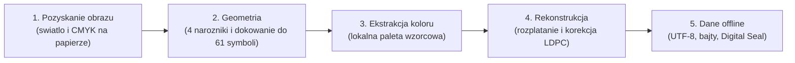

W lutym 2021 roku opisałem na tym blogu [eksperyment z wykorzystaniem JAB Code do zapisywania nagrań głosu w mozaice z klocków LEGO](/blog/2021-02-23/jab-code-and-everything-you-need-to-know-about-color-bar-code). Pięć lat później tamta fascynacja zasługuje na pełne, usystematyzowane dossier badawcze. JAB Code — czyli _Just Another Barcode_ — przestał być jedynie niszową ciekawostką z laboratorium: przeszedł drogę od niemieckich wytycznych urzędowych przez międzynarodową normę **ISO/IEC 23634:2022**, aż po zaktualizowaną w 2026 roku specyfikację cyfrowych pieczęci zawierających wizerunki twarzy na papierze. Poniższy dokument zbiera jego historię, ilościowy bilans wcześniejszych porażek, mechanikę działania rozłożoną na etapy bez użycia równań, aktualne wąskie gardła oraz szerokie tło historyczne.

## 1. Wprowadzenie: Geneza, paradoks i stawka wielobarwnych kodów

- **Zdarzenie inicjujące i geneza:** Prace nad JAB Code rozpoczęły się w niemieckim instytucie **Fraunhofer Institute for Secure Information Technology (Fraunhofer SIT)** w Darmstadt na zlecenie niemieckiego Federalnego Urzędu ds. Bezpieczeństwa Informacji (**BSI** — _Bundesamt für Sicherheit in der Informationstechnik_). Celem było stworzenie otwartego, wolnego od opłat licencyjnych kodu dwuwymiarowego o pojemności wystarczającej do umieszczania na zwykłym papierze całych pakietów danych podpisanych kryptograficznie. Efektem prac stała się wytyczna techniczna **BSI TR-03137 Część 2** (opublikowana **4 sierpnia 2020 roku**), a następnie pełna norma międzynarodowa **ISO/IEC 23634**, ogłoszona **20 kwietnia 2022 roku**.
- **Kluczowi twórcy i kontekst powstania:** Za architekturę, algorytmy korekcji błędów oraz referencyjną bibliotekę w języku C odpowiadał zespół badawczy Fraunhofer SIT w składzie **Waldemar Berchtold**, **Huajian Liu**, **prof. dr Martin Steinebach**, **Tobias Senger** i **Nicolas Thenée**, we współpracy z **Dominikiem Kleinem** z BSI. Impulsem nie był marketing ani szybkie otwieranie linków na plakatach, lecz **cyfrowa pieczęć** (_Digital Seal_) dla dokumentów nieelektronicznych: wiz, naklejek adresowych w dowodach osobistych, dyplomów, aktów urodzenia i faktur, które muszą dać się zweryfikować w terenie **bez połączenia z internetem i bez dostępu do centralnej bazy danych**.
- **Centralny paradoks:** Pomysł, by zamiast samej czerni i bieli użyć kolorowych kwadratów i w ten sposób pomnożyć pojemność kodu na tej samej powierzchni, wydaje się trywialny. Mimo to przez ponad dwie dekady kolejne komercyjne systemy kolorowych kodów upadały jeden po drugim, podczas gdy czarno-biały kod QR podbił cały świat. Paradoks polega na tym, że kolor daje ogromny zysk informacyjny w pamięci komputera, ale w świecie fizycznym — na zwykłym papierze biurowym, pod tanim tuszem atramentowym i w zmiennym świetle żarówki — staje się wyjątkowo niestabilny.
- **Skala stawki:** Klasyczny kod QR w swojej największej wersji mieści niespełna trzy kilobajty danych, co wystarcza na krótki tekst lub podpisany skrót, ale nie pozwala łatwo zmieścić w niewielkim polu bogatej metryki, certyfikatu i danych biometrycznych jednocześnie. Przejście na **4 kolory** podwaja, a na **8 kolorów** niemal potraja gęstość zapisu w przeliczeniu na milimetr kwadratowy. W połączeniu z możliwością dokowania wielu symboli w nieregularne kształty pozwala to przenieść na papier nawet dane biometryczne i skompresowany wizerunek twarzy, bez uzależniania weryfikacji od chmury.

## 2. Lata zmagań: Wczesne próby i policzone straty

Historia optycznego kodowania o podwyższonej gęstości przed powstaniem JAB Code to pasmo błyskotliwych pomysłów inżynieryjnych, które rozbijały się o koszty druku, brak otwartych standardów albo zamknięte ekosystemy serwerowe.

### Chronologia wcześniejszych podejść fizycznych i komercyjnych

1. **Lata 90. XX wieku — Xerox DataGlyphs (PARC):** Naukowcy z ośrodka Xerox Palo Alto Research Center zakodowali bity w tysiącach mikroskopijnych ukośnych kresek nachylonych w lewo lub w prawo pod kątem czterdziestu pięciu stopni. Z daleka taki blok wyglądał jak jednolite szare tło formularza, więc nie szpecił dokumentów i potrafił ukryć cały cyfrowy oryginał strony na niej samej. System wymagał jednak bardzo precyzyjnego druku i wysokiej jakości skanerów biurowych, przez co nie przyjął się w obiegu masowym.
2. **2001 r. — ColorCode (ColorZip Media, Korea Południowa):** Koreańska firma skomercjalizowała wielokolorową matrycę projektowaną z myślą o wczesnych telefonach z aparatem, które skanowały kody wprost z ekranów telewizorów, gazet i reklam ulicznych. Choć ColorCode wyprzedził zachodnią falę kodów mobilnych o kilka lat, pozostał rozwiązaniem własnościowym o zasięgu głównie regionalnym.
3. **2007 r. — High Capacity Color Barcode / HCCB (Gavin Jancke, Microsoft Research):** Zespół Gavina Janckego zastąpił tradycyjne czarno-białe kwadraty gęstą siatką kolorowych trójkątów (w wariantach cztero- i ośmiokolorowych). Pierwsze wdrożenia testowała m.in. agencja ISAN do identyfikacji materiałów audiowizualnych. Sama geometria trójkątów zwiększała gęstość, ale bez pełnego otwarcia specyfikacji.
4. **Styczeń 2009 r. – 19 sierpnia 2015 r. — Wzlot i zamknięcie Microsoft Tag:** Na targach CES w 2009 roku Microsoft przekształcił HCCB w usługę konsumencką **Microsoft Tag**. Zamiast przechowywać pełny ładunek offline na papierze, kolorowe trójkąty pełniły funkcję „skracacza linków” odpytującego serwery Microsoftu. Zwykłe czarno-białe kody QR okazały się jednak prostsze w druku i niezależne od jednego dostawcy. **19 sierpnia 2013 roku** Microsoft ogłosił wygaszanie usługi, a **19 sierpnia 2015 roku** ostatecznie wyłączył serwery — wszystkie wydrukowane wcześniej kody Microsoft Tag przestały działać z dnia na dzień.
5. **2007 r. — Równoległe projekty niszowe (Ultracode i Twibright Optar):** W tym samym okresie przemysłowy standard **Ultracode** (kojarzony z rozwiązaniami Zebra Technologies i organizacją AIM) dopuszczał kolorowy wariant o podwyższonej gęstości z korekcją Reeda-Solomona, a czeski programista **Karel Kulhavý** z Twibright Labs opublikował otwarty kodek **Optar** (_OPTical ARchiver_), pozwalający wydrukować około 200 kilobajtów danych binarnych na jednej kartce A4 w drukarce laserowej 600 dpi. Oba rozwiązania nigdy jednak nie doczekały się masowej adopcji w telefonach ani powszechnej standaryzacji dokumentowej.

### Bilans ilościowy: Punkt wyjścia, straty i zachowane możliwości

- **Sufit czarno-białego kodu QR:** Największy pojedynczy kod QR (wersja 40, czyli siatka **177 na 177 modułów**, dająca **31 329 pól**) mieści maksymalnie **2 953 bajty** surowych danych binarnych przy najniższym poziomie korekcji błędów L (odzyskującym jedynie około **7 procent** uszkodzeń). Przy praktycznym poziomie M (około **15 procent** ochrony) pojemność spada do **2 331 bajtów**.
- **Bilans wczesnych wdrożeń kolorowych:** Z trzech głośnych inicjatyw kolorowych pierwszej dekady XXI wieku (ColorCode, Microsoft Tag / HCCB oraz kolorowy wariant Ultracode) żadna nie utrzymała pozycji uniwersalnego standardu konsumenckiego. Flagowy projekt Microsoftu przetrwał na rynku zaledwie **6 lat** od premiery komercyjnej w 2009 roku do wyłączenia serwerów w 2015 roku, pozostawiając po sobie 100 procent bezużytecznych odnośników w druku.
- **Przewaga uzyskana w architekturze JAB Code:** Pojedynczy symbol JAB Code skaluje się w 32 rozmiarach — od **21 na 21 modułów** (wersja 1) aż do **145 na 145 modułów** (wersja 32) — i może łączyć w jednej kaskadzie do **61 symboli naraz** (1 symbol główny oraz do 60 symboli wtórnych). Zgodnie z danymi porównawczymi z dokumentacji Fraunhofer SIT i BSI symbol złożony z siatki **85 na 85 modułów** (**7 225 kolorowych pól**) o fizycznym wymiarze około **7 na 7 centymetrów** zastępuje przy porównywalnej odporności na błędy kod QR o powierzchni około **2,5 raza większej**.

## 3. Przełom technologiczny: Fizyka i mechanika działania JAB Code

Aby zrozumieć, dlaczego JAB Code działa tam, gdzie wcześniejsze kody kolorowe zawodziły, warto rozłożyć cały proces kodowania i odczytu na sześć kolejnych etapów fizycznych i obliczeniowych — bez odwoływania się do jakichkolwiek wzorów.

### 3.1 Etap 1: Pozyskiwanie obrazu i fizyka koloru na papierze

Zwykły kod QR potrzebuje od aparatu wyłącznie odpowiedzi na binarne pytanie: czy dane pole jest jasne, czy ciemne. JAB Code przenosi decyzję w przestrzeń trójwymiarową barw. Ponieważ dokumenty drukuje się na papierze, projektanci oparli domyślne tryby na modelu drukarskim **CMYK**, a nie ekranowym RGB. W trybie **4-kolorowym** system używa czterech podstawowych farb drukarskich: cyjanu, magenty, żółci i czerni. W trybie **8-kolorowym** dokłada barwy wtórne powstające z ich połączeń oraz tło papieru: niebieski, czerwony, zielony i biały. Kiedy światło dzienne lub światło lampy pada na wydruk i odbija się do matrycy aparatu w smartfonie, telefon nie rejestruje „czystych” kolorów z pliku źródłowego — odbiera barwy zniekształcone przez chłonność papieru, mieszanie tuszu i temperaturę barwową otoczenia.

### 3.2 Etap 2: Modelowanie geometrii i wąskie gardło układu bez marginesu ciszy

Każdy JAB Code składa się z jednego obowiązkowego **symbolu głównego** (_primary symbol_) oraz opcjonalnych **symboli wtórnych** (_secondary symbols_), których łączna liczba w całej strukturze może sięgnąć **61 sztuk** (1 główny i do 60 dołączonych wtórnych). Symbol główny ma w czterech narożnikach charakterystyczne wielobarwne **wzorce lokalizacyjne** (_finder patterns_). Pozwalają one dekoderowi wykryć obrót, pochylenie perspektywiczne, odbicie lustrzane oraz gęstość siatki.

Symbole wtórne dokuje się krawędziowo — w pionie lub poziomie — do symbolu głównego albo do kolejnych symboli wtórnych. Co ważne, **symbole wtórne nie potrzebują własnych narożnych celowników**, dzięki czemu cały kod nie musi być kwadratem. Może tworzyć prostokąt, kształt litery L albo U i dosłownie opływać fotografię lub pieczęć na dokumencie. Co więcej, w przeciwieństwie do kodu QR, JAB Code **nie wymaga pustego białego marginesu ciszy** (_quiet zone_) dookoła siatki. To ogromna zaleta przy ciasnym projektowaniu wiz i kart, ale też poważne wyzwanie dla algorytmu detekcji: program musi bezbłędnie odróżnić narożniki kodu od sąsiadujących linii formularza, tekstu i grafiki tła.

### 3.3 Etap 3: Ekstrakcja sygnału i dynamiczna kalibracja palety barw

Największe ryzyko w kodach kolorowych polega na tym, że żółty w ciepłym świetle żarówki potrafi przypominać biel, a ciemnoniebieski na taniej drukarce zbliża się do czerni. Gdyby dekoder porównywał piksele ze sztywną tabelą wzorcowych kolorów zapisaną w aplikacji, połowa skanów zakończyłaby się błędem.

JAB Code rozwiązuje ten problem przez **wbudowaną redundantną paletę referencyjną**. W kilku miejscach wewnątrz samego symbolu — w bezpośrednim sąsiedztwie wzorców lokalizacyjnych i metadanych — znajdują się wzorcowe komórki prezentujące wszystkie kolory użyte w danym kodzie. Dekoder działa więc jak malarz, który najpierw patrzy na próbnik farb leżący w tym samym cieniu co obraz: odczytuje rzeczywisty wygląd każdego koloru w konkretnym oświetleniu i z konkretnej drukarki, buduje lokalną mapę odcieni dla bieżącego zdjęcia i dopiero wtedy klasyfikuje kolejne pola siatki danych.

### 3.4 Etap 4: Rekonstrukcja strumienia bitów, przeplatanie i korekcja LDPC

Po zamianie kolorowych pól z powrotem na bity system musi naprawić błędy wynikające z zabrudzeń, rys, zagięć papieru czy błędnego odczytu pojedynczych odcieni. Zanim jeszcze koder narysuje choćby jeden kolorowy kwadrat, wykonuje dwa kroki ochronne:

- **Przeplatanie danych (_interleaving_):** Bity wiadomości i bity kontrolne są celowo tasowane według ustalonego wzoru i rozsypywane po całej powierzchni symbolu. Dzięki temu plama kawy, zarysowanie czy odblask lampy błyskowej nie niszczą jednego spójnego zdania czy podpisu, lecz zostawiają drobne, odizolowane „dziurki” rozrzucone po całym kodzie, które łatwiej połatać.
- **Korekcja LDPC (_Low-Density Parity-Check_):** Zamiast klasycznych kodów Reeda-Solomona używanych w kodach QR, JAB Code wykorzystuje nowoczesną korekcję LDPC (w implementacji referencyjnej dostępną na 10 regulowanych poziomach nadmiarowości). Najprościej wyobrazić ją sobie jako sieć krzyżujących się reguł sprawdzających: każdy bit danych należy do kilku niezależnych grup kontrolnych rozsianych po siatce. Gdy aparat nie jest pewien koloru kilku pól, dekoder przekazuje tę wątpliwość dalej i w kilku kolejnych przebiegach „negocjuje” między grupami kontrolnymi najbardziej spójną wersję całego komunikatu, aż wszystkie reguły parzystości zaczną się zgadzać. Na końcu odzyskiwany jest czysty strumień bajtów lub znaków UTF-8, także przy przekroczeniu granic między symbolami głównym i wtórnymi.

### 3.5 Dowód słuszności koncepcji: Demonstracje Fraunhofer SIT i wytyczna BSI (2018–2020)

Pierwsze działające prototypy Fraunhofer SIT prezentował na branżowych targach (w tym na **CeBIT**) oraz w ramach prac badawczych centrum **ATHENE**, demonstrując m.in. wbudowane narzędzie **DocSeal** do szybkiego sprawdzania autentyczności certyfikatów i faktur. W **2019 i 2020 roku** zespół Waldemara Berchtolda i Huajiana Liu opublikował szczegółowy opis naukowy architektury na konferencji _IS&T Electronic Imaging 2020_ pod tytułem _„JAB Code - A Versatile Polochrome 2D Barcode”_, a **4 sierpnia 2020 roku** niemiecki urząd BSI wydał oficjalną specyfikację **BSI TR-03137 Part 2 Version 1.0**. Pokazało to w praktyce, że wielokolorowy kod można drukować na standardowym sprzęcie biurowym i odczytywać telefonem z Androidem bez chmury.

### 3.6 Główny impas fizyczny: Dlaczego 64 i 256 kolorów przegrywa z drukarką biurową

Teoretycznie architektura JAB Code potrafi skalować paletę w kolejnych potęgach dwójki: od **4 i 8**, przez **16, 32 i 64**, aż po **128 i 256 kolorów** w ogólnym modelu matematycznym (przy czym w pojedynczym symbolu wbudowane pola kalibracyjne obsługują do 64 barw). Dlaczego więc niemal wszystkie praktyczne wdrożenia — i sama norma ISO/IEC 23634 — koncentrują się na zaledwie **4 lub 8 kolorach**?

Na drodze stanęła czysta fizyka druku i optyki:

1. **Konwersja w sterownikach drukarek:** Biurowe drukarki atramentowe i laserowe nie nakładają dokładnie tych barw, które widzi komputer — sterownik po cichu przelicza je pod własne profile papieru i oszczędzania tuszu.
2. **Rozlewanie tuszu i rasteryzacja:** Przy palecie 64 odcieni drukarka musi mieszać sąsiednie kropki barwnika (_halftoning_), przez co na poziomie pojedynczego milimetrowego kwadratu zamiast gładkiego koloru powstaje chmura mikroskopijnych kropek.
3. **Automatyczny balans bieli i odblaski:** Smartfon na bieżąco zmienia ekspozycję i nasycenie obrazu, co przy zbyt gęsto upakowanych odcieniach sprawia, że sąsiednie kolory zaczynają na siebie zachodzić.

Mostem inżynieryjnym, który pozwolił pokonać ten impas, okazał się pragmatyzm: zamiast wyciskać maksimum z 64 lub 256 kolorów w jednym małym kwadracie, twórcy postawili na **maksymalnie rozseparowane palety 4- i 8-kolorowe**, a brakującą pojemność odzyskali przez bezpieczne, kaskadowe dokowanie kolejnych symboli wtórnych.

## 4. Katalizator: Otwarty kod, standaryzacja ISO i przejście na licencję MIT

To, co ostatecznie odróżniło JAB Code od zamkniętego Microsoft Tag, wydarzyło się na styku otwartego oprogramowania i międzynarodowej standaryzacji:

- **Skok sprzętowy po stronie czytelnika:** Upowszechnienie aparatów smartfonowych o wysokiej rozdzielczości i szybkim autofokusie sprawiło, że pojedyncze barwne moduły o ułamku milimetra stały się wyraźnie rozróżnialne bez drogich skanerów laserowych czy przemysłowych kamer maszynowych.
- **Skok metodologiczny:** Połączenie otwartego nośnika optycznego z gotowym profilem kryptografii asymetrycznej z **BSI TR-03137 Część 1** dało instytucjom publicznym kompletny przepis na „cyfrową pieczęć” odporną na fałszerstwa.
- **Otwarcie źródeł i zmiana licencji:** Fraunhofer SIT opublikował koder, dekoder, czytnik dla Androida oraz portal testowy `jabcode.org` jako otwarte oprogramowanie w repozytorium `github.com/jabcode/jabcode`. Początkowo kod udostępniono na licencji **GNU LGPL v2.1**, a w późniejszych pracach konserwacyjnych repozytorium przeszło na jeszcze bardziej liberalną licencję **MIT**, usuwając obawy firm przed włączaniem kodu w zamknięte produkty komercyjne.
- **Kamień milowy z 20 kwietnia 2022 roku:** Międzynarodowa Organizacja Normalizacyjna oficjalnie opublikowała standard **ISO/IEC 23634:2022** (_Information technology — Automatic identification and data capture techniques — JAB Code polychrome bar code symbology specification_), nadając niemieckiemu projektowi rangę globalnej, wolnej od opłat patentowych normy.

## 5. Najnowsze odkrycia i przełomy wdrożeniowe (2022–2026)

Choć sama norma ISO dla warstwy optycznej powstała w 2022 roku, najważniejszy skok po stronie zastosowań dokumentowych przyniosły lata **2024–2026**.

- **Przełom z sierpnia i września 2026 roku — BSI TR-03137 Część 1 Wersja 3.0:** Niemiecki urząd BSI opublikował trzecią główną wersję specyfikacji cyfrowej pieczęci (_Digital Seal_), wprowadzając generyczny profil zgodny z wytycznymi Organizacji Międzynarodowego Lotnictwa Cywilnego (**ICAO TR-IDB**) oraz zaktualizowane profile dokumentów urzędowych, w tym specjalny profil dla naklejek adresowych umieszczanych na zezwoleniach pobytowych.
- **Przełom treściowy — wizerunek twarzy bezpośrednio w kodzie na papierze:** Wersja 3.0 z 2026 roku wprowadziła obsługę zapisu **zdjęcia twarzy posiadacza dokumentu** bezpośrednio wewnątrz optycznej pieczęci obok danych tekstowych. To moment, w którym wysoka gęstość JAB Code realizuje swoje pierwotne przeznaczenie: kontroler na granicy lub w urzędzie może zeskanować papierowy dokument offline i porównać wydrukowaną fotografię z kryptograficznie podpisanym wizerunkiem odzyskanym z samego kodu, co skutecznie blokuje podmianę zdjęcia przez fałszerza.
- **Społecznościowe archiwizacje długoterminowe:** Poza administracją publiczną JAB Code stał się narzędziem eksperymentów z trwałością danych bez chmury — od zapisu plików dźwiękowych na archiwalnym papierze fotograficznym po budowę fizycznych mozaik z klocków ABS, które mogą przetrwać setki lat bez elektroniki.

## 6. Aktywne horyzonty: Nierozwiązane bariery i wyścig o adopcję (stan na 2026 r.)

W przeciwieństwie do głośnych konkursów naukowych z wielomilionowymi nagrodami pieniężnymi, w świecie JAB Code nie toczy się dziś rywalizacja o żadną ukrytą nagrodę finansową. Mimo to technologia nie jest jeszcze problemem „zamkniętym”. Między istnieniem gotowej normy ISO/IEC 23634 a codzienną powszechnością, jaką cieszy się dziś kod QR, wciąż stoją bardzo konkretne, nierozwiązane bariery inżynieryjne i ekosystemowe:

### Pięć aktywnych progów do pokonania

1. **Brak natywnego wsparcia w aparatach iOS i Android:** Gdy kierujesz domyślny aparat iPhone’a lub telefonu z Androidem na kod QR, system od razu rozpoznaje treść. W przypadku JAB Code systemowe aparaty nie robią nic. Dopóki dekoder JAB Code nie trafi bezpośrednio do bibliotek systemowych lub wiodących projektów wieloformatowych (na GitHubie toczyły się m.in. dyskusje społeczności o współpracy i integracji z popularną biblioteką `zxing-cpp`), użycie wymaga dedykowanej aplikacji.
2. **Stan utrzymania referencyjnego repozytorium C:** Oficjalne repozytorium `jabcode/jabcode` na GitHubie jest dziś utrzymywane w trybie konserwacyjnym — bez opublikowanych gotowych paczek binarnych w zakładce _Releases_ i bez regularnych wydań dla nowoczesnych środowisk (takich jak WebAssembly, Rust, Swift czy gotowe paczki mobilne). Każdy zespół chcący wdrożyć JAB Code musi samodzielnie kompilować kod źródłowy w języku C i radzić sobie z problemami na nowszych kompilatorach lub pisać własne wrappery.
3. **Szklany sufit 8 kolorów poza laboratorium:** Odblokowanie stabilnego odczytu dla palet **16, 32 czy 64 kolorów** na zwykłych drukarkach biurowych, papierze z recyklingu oraz pod mieszanym oświetleniem LED i słonecznym wciąż pozostaje otwartym wyzwaniem badawczym w zakresie kalibracji barw.
4. **Tolerancja odblasków i szybkość dekodowania na laminacie:** Dokumenty tożsamości i karty plastikowe bywają pokryte folią holograficzną lub laminatem. Odblask lampy w jednym narożniku potrafi zaburzyć lokalną paletę barw mocniej niż na matowym papierze, co stawia wysokie wymagania przed algorytmami rekonstrukcji w czasie rzeczywistym.
5. **Współistnienie z cyfrowymi portfelami tożsamości (eIDAS 2.0 / EUDI Wallet):** W Europie trwa intensywne wdrażanie elektronicznych portfeli tożsamości w smartfonach. Oznacza to, że JAB Code nie walczy dziś o bycie jedynym nośnikiem tożsamości, lecz o pozycję niezawodnego, odpornego na brak zasięgu i brak baterii **papierowego odpowiednika** dla dokumentów awaryjnych, wiz i zaświadczeń transgranicznych.

### Czy da się wdrożyć skaner JAB Code bezpośrednio w przeglądarce internetowej?

**Tak — wdrożenie skanera JAB Code działającego w całości po stronie klienta w przeglądarce internetowej jest technicznie możliwe**, a pierwsze eksperymentalne porty społecznościowe (takie jak projekt **JABCodeJS** kompilujący oryginalną bibliotekę C do przeglądarki czy próby **srlehn/jabcode** wykorzystujące środowisko uruchomieniowe w przeglądarce) pokazały, że nie wymaga to instalowania natywnej aplikacji ani wysyłania zdjęć dokumentów na zewnętrzny serwer.

#### Dlaczego jest to możliwe

1. **Samowystarczalny rdzeń w języku C na licencji MIT:** Referencyjna biblioteka Fraunhofer SIT nie jest przywiązana do konkretnego systemu operacyjnego ani do dedykowanych sterowników sprzętu. Operuje na surowym obrazie w pamięci, dlatego przy użyciu narzędzi kompilacji takich jak **Emscripten** daje się przełożyć na moduł **WebAssembly** uruchamiany w piaskownicy przeglądarki z wydajnością zbliżoną do kodu natywnego.
2. **Bezpośredni dostęp przeglądarki do obrazu z kamery:** Współczesne przeglądarki pozwalają pobrać za zgodą użytkownika strumień wideo z aparatu telefonu lub kamery laptopa, przenieść pojedynczą klatkę na niewidoczny obszar roboczy rysowania i przekazać surową tablicę kolorów pikseli wprost do pamięci modułu WebAssembly — całkowicie lokalnie i bez łączności z siecią.
3. **Przetwarzanie w tle bez zawieszania strony:** Dzięki mechanizmowi **Web Workers** ciężkie etapy analizy geometrycznej i wielokrotnego uzgadniania parzystości LDPC można wydzielić poza główny wątek interfejsu użytkownika, dzięki czemu podgląd z kamery pozostaje płynny.
4. **Wbudowana odporność kalibracji kolorów:** Ponieważ JAB Code nosi własną paletę wzorcową wewnątrz każdego symbolu, dekoder działający w przeglądarce nie potrzebuje fabrycznego profilu konkretnego aparatu — sam na bieżąco kalibruje odcienie z dostarczonej klatki.

#### Dlaczego w przeglądarce jest to trudniejsze niż przy kodach QR

1. **Brak wsparcia w natywnym API przeglądarki:** Wbudowany w nowoczesne przeglądarki interfejs detekcji kodów (**Barcode Detection API**) oddaje rozpoznawanie zoptymalizowanym silnikom systemu operacyjnego, ale obsługuje wyłącznie tradycyjne formaty — takie jak QR Code, Data Matrix, Aztec, PDF417 czy klasyczne kody jednowymiarowe EAN i Code 128. JAB Code nie znajduje się na tej liście, więc cała praca spada na dołączony przez stronę moduł WebAssembly.
2. **Nierówna kontrola nad optyką aparatu:** Natywne aplikacje mobilne potrafią precyzyjnie zablokować ostrość makro, czas naświetlania i balans bieli. W przeglądarce — szczególnie na urządzeniach z systemem iOS w porównaniu z przeglądarką Chrome na Androidzie — kontrola nad ręcznym ostrzeniem z bliska bywa mocno ograniczona, przez co drobne kolorowe moduły łatwiej się rozmywają.
3. **Dodatkowa warstwa konwersji barw:** Zanim klatka z kamery trafi do dekodera, przechodzi przez potok przetwarzania przeglądarki i mapowanie przestrzeni barw (na przykład z szerokiego gamutu ekranu do standardowego profilu sRGB), co przy słabszym świetle może subtelnie zbliżać sąsiednie odcienie w palecie.
4. **Koszt obliczeniowy dużych kaskad:** Przy prostym symbolu 4- lub 8-kolorowym dekoder w WebAssembly radzi sobie bardzo sprawnie, natomiast przy rozbudowanych kaskadach złożonych z kilkudziesięciu połączonych symboli czas analizy jednej klatki zauważalnie rośnie i wymaga rygorystycznego ograniczania rozdzielczości oraz liczby przetwarzanych klatek na sekundę.

## 7. Podsumowanie: Przyszłe horyzonty i wielkie porównanie historyczne

W ciągu niespełna dekady JAB Code przeszedł drogę od eksperymentu naukowego z Darmstadt do międzynarodowej normy **ISO/IEC 23634** oraz realnej infrastruktury urzędowej w wytycznej **BSI TR-03137 Wersja 3.0**. Nawet jeśli nigdy nie zastąpi czarno-białych kodów QR na stolikach w restauracjach — gdzie taniość druku termicznego i kilka znaków adresu internetowego w zupełności wystarczają — znalazł swoją unikalną niszę wszędzie tam, gdzie liczy się **niezależność od sieci, kryptograficzne zaufanie i maksymalna ilość danych na małym skrawku papieru**.

Jeśli w nadchodzących latach doczekamy się lekkiego, w pełni utrzymywanego dekodera w WebAssembly oraz natywnego wsparcia w otwartych bibliotekach skanujących, kolorowe matryce mogą przeżyć drugą młodość zarówno w paszportach produktów UE, jak i w obywatelskiej archiwizacji offline.

### Katalog porównawczy: Przełomowe i zapomniane systemy optycznego zapisu danych (1890–2022)

Aby zobaczyć, jak wyjątkowe miejsce zajmuje JAB Code, warto zestawić go z dziewięcioma innymi kamieniami milowymi w historii zapisu danych czytelnych maszynowo na papierze i nośnikach fizycznych:

1. **Karty perforowane Hermana Holleritha (1890):** Stworzone do spisu powszechnego w USA; zapisywały dane mechanicznie jako otwory w kartonie w układzie wierszy i kolumn. Przyspieszyły obliczenia z lat do miesięcy, ale miały minimalną gęstość i zerową odporność na rozdarcia bez powielania kart.
2. **Koncentryczna „tarcza strzelnicza” Normana Josepha Woodlanda i Bernarda Silvera (1949 / patent 1952):** Pierwszy prawdziwy kod kreskowy inspirowany alfabetem Morse’a rozciągniętym w grube i cienkie linie zwinięte w okręgi, by dało się go skanować pod dowolnym kątem. Wyprzedził elektronikę swoich czasów o dwie dekady — ówczesne lampy i fotokomórki były zbyt wolne i zawodne.
3. **Kod kreskowy UPC i George Laurer (1973/1974):** Liniowy kod jednowymiarowy wybrany przez branżę spożywczą w USA zamiast tarczy Woodlanda; 26 czerwca 1974 roku zeskanowano pierwszy produkt (paczkę gum Wrigley’s w Ohio). Zrewolucjonizował handel, lecz mieści zaledwie kilkanaście cyfr i działa wyłącznie jako klucz do bazy sklepu.
4. **PDF417 dr. Ynjiuna P. Wanga (1991, Symbol Technologies):** Piętrowy kod łączący wiele wąskich pasków jednowymiarowych w jeden prostokąt z korekcją błędów. Do dziś spotykany na amerykańskich prawach jazdy i kartach pokładowych — mieści nieco ponad tysiąc bajtów, ale zajmuje znacznie więcej miejsca niż matryce 2D.
5. **Kod QR Masahiro Hary i zespołu Denso Wave (1994, Japonia):** Zainspirowany czarno-białymi kamieniami gry Go, zaprojektowany do błyskawicznego śledzenia części samochodowych Toyoty. Denso Wave nie egzekwowało praw patentowych, co dało kodowi QR globalny monopol konsumencki, choć pozostał on ograniczony do dwóch stanów (czarnego i białego) i maksymalnie niespełna 3 kilobajtów.
6. **Aztec Code Andrew Longacre’a Jr. i Roberta Husseya (1995, Welch Allyn):** Matryca 2D z charakterystyczną koncentryczną „piramidą” na samym środku. Podobnie jak JAB Code nie wymaga białego marginesu ciszy, dzięki czemu stała się standardem w biletach kolejowych i lotniczych — pozostaje jednak jednobarwna.
7. **Xerox DataGlyphs (lata 90. XX wieku, PARC):** Subtelny dywan mikroskopijnych ukośnych kresek wyglądający jak szare tło strony. Imponował estetyką, ale przegrał z wymaganiami sprzętowymi wysokiej rozdzielczości druku.
8. **ColorCode południowokoreańskiego ColorZip Media (2001):** Pionierska próba przeniesienia wielobarwnych siatek na ekrany telewizorów i telefony komórkowe na długo przed erą iPhone’a i Androida. Rozbił się o brak otwartego standardu międzynarodowego.
9. **Han Xin Code oraz Twibright Optar (2007):** Chiński standard **Han Xin Code** (później ISO/IEC 20830) zoptymalizował gęste kodowanie znaków chińskich, a otwarty **Optar** Karela Kulhavego wycisnął z czarno-białego druku laserowego 600 dpi około 200 kilobajtów na stronę A4 do archiwizacji plików. Oba pozostały jednak poza głównym nurtem codziennych aparatów telefonicznych.
10. **Microsoft HCCB / Microsoft Tag Gavina Janckego (2007–2015):** Najgłośniejszy komercyjny poprzednik JAB Code. Pokazał potencjał kolorowych trójkątów, ale uzależnił całe rozwiązanie od własnościowej chmury — po wyłączeniu serwerów w sierpniu 2015 roku stał się przestrogą, dlaczego standard kodów papierowych musi być otwarty i samowystarczalny offline.

## 8. Źródła i dokumenty referencyjne

1. **Oficjalne portale i kod źródłowy**
   - [Oficjalny portal demonstracyjny JAB Code (Fraunhofer SIT)](https://jabcode.org/) — dokumentacja ogólna oraz generator i dekoder testowy online.
   - [Repozytorium referencyjne `jabcode/jabcode` na GitHubie](https://github.com/jabcode/jabcode) — kod źródłowy kodera, dekodera i czytnika w języku C (aktualnie na licencji MIT).
   - [Strona projektu JAB Code w Fraunhofer SIT](https://www.sit.fraunhofer.de/en/jabcode/) — przegląd zastosowań, m.in. w rozwiązaniu _DocSeal_.
2. **Normy międzynarodowe i wytyczne techniczne**
   - _ISO/IEC 23634:2022 — Information technology — Automatic identification and data capture techniques — JAB Code polychrome bar code symbology specification_ (opublikowana 20 kwietnia 2022 r.).
   - [BSI TR-03137 — Optically Verifiable Cryptographic Protection of Non-Electronic Documents (Digital Seal)](https://www.bsi.bund.de/EN/Service-Navi/Publications/TechnicalGuidelines/TR03137/BSITR03137.html) — oficjalny portal wytycznych niemieckiego BSI, w tym **Część 2 (JAB Code v1.0, 4 sierpnia 2020 r.)** oraz **Część 1 Wersja 3.0 (2026 r.)**.
3. **Podstawowe publikacje naukowe**
   - Berchtold, W., Liu, H., Steinebach, M., Klein, D., Senger, T., & Thenée, N. (2020). _JAB Code - A Versatile Polochrome 2D Barcode_. IS&T International Symposium on Electronic Imaging 2020 — [abstrakt w Ingenta Connect](https://www.ingentaconnect.com/content/ist/ei/2020/00002020/00000003/art00004).
4. **Wdrożenia, aktualizacje i kontekst społecznościowy**
   - Informacje o aktualizacji **BSI TR-03137 Part 1 Version 3.0** (sierpień/wrzesień 2026 r., integracja z profilem ICAO TR-IDB oraz zapis wizerunku twarzy w kodzie) w serwisie [bsi.bund.de](https://www.bsi.bund.de/EN/Service-Navi/Publications/TechnicalGuidelines/TR03137/BSITR03137.html).
   - Eksperymentalne porty przeglądarkowe i WebAssembly: [TMSSassen/JABCodeJS](https://github.com/TMSSassen/JABCodeJS) oraz [srlehn/jabcode](https://github.com/srlehn/jabcode), a także lista obsługiwanych formatów natywnego interfejsu przeglądarek w dokumentacji [MDN Barcode Detection API](https://developer.mozilla.org/en-US/docs/Web/API/Barcode_Detection_API).
   - [Wcześniejszy wpis na Hvitis.dev (2021): JAB Code i eksperyment zapisu dźwięku w mozaice LEGO](/blog/2021-02-23/jab-code-and-everything-you-need-to-know-about-color-bar-code).
5. **Kontekst historyczny i porównawczy**
   - Woodland, N. J., & Silver, B. (1952). _Classifying Apparatus and Method_ (U.S. Patent 2,612,994, zgłoszony w 1949 r.).
   - Twibright Labs — dokumentacja otwartego archiwizatora optycznego [Twibright Optar](http://twibright.com/optar/).
